# Dicionário de Dados do Banco de Dados - FrotaSaaS Enterprise 2.0
## Modelo Documental de Persistência Híbrida (MongoDB Server & Mongita Disk)

---

### 1. Visão Geral da Camada de Dados

O banco de dados do **FrotaSaaS Enterprise** opera sobre uma arquitetura NoSQL Documental de alta performance e resiliência, estruturada com o motor **MongoDB 5.0+** e compatível integralmente com o motor embutido **Mongita Disk** (zero-setup em disco local).

#### Convenções Gerais do Banco:
* **Identificadores Únicos (`id`)**: Gerados como `ObjectId` hexadecimal de 24 caracteres (BSON), tratados na camada de aplicação como `str`.
* **Datas e Horários**: Formatados em string ISO 8601 UTC (`YYYY-MM-DDTHH:MM:SSZ`) ou formato estrito de data civil (`YYYY-MM-DD`).
* **Valores Monetários e Numéricos**: Ponto flutuante IEEE 754 de precisão dupla (`float`) ou inteiros de 64 bits (`int`).
* **Soberania e Localização (LGPD)**: Todos os registros de telemetria, condutores e operações residem estritamente em disco ou servidor alocado em território brasileiro.

---

### 2. Diagrama Entidade-Relacionamento (ERD)

```mermaid
erDiagram
    USUARIOS ||--o{ CHAVES_API : emite
    VEICULOS ||--o{ EQUIPAMENTOS_EMBARCADOS : possui
    VEICULOS ||--o{ TELEMETRIA_PINGS : emite
    VEICULOS ||--|| POSICOES_INSTANTANEAS : mantem
    VEICULOS ||--o{ EVENTOS_CONDUCAO : registra
    VEICULOS ||--o{ ORDENS_SERVICO : recebe
    VEICULOS ||--o{ PNEUS : equipa
    VEICULOS ||--o{ ABASTECIMENTOS : consome
    VEICULOS ||--o{ PEDAGIOS : trafega
    VEICULOS ||--o{ VIAGENS : aloca
    VEICULOS ||--o{ MULTAS : autuado
    VEICULOS ||--o{ SINISTROS : reporta
    VEICULOS ||--o{ DOCUMENTOS_VENCIMENTO : tributado

    MOTORISTAS ||--o{ EVENTOS_CONDUCAO : conduz
    MOTORISTAS ||--o{ ABASTECIMENTOS : abastece
    MOTORISTAS ||--o{ VIAGENS : escala
    MOTORISTAS ||--o{ CHECKLISTS_DIGITAIS : vistoria
    MOTORISTAS ||--o{ MULTAS : pontuado

    VIAGENS ||--o{ CHECKLISTS_DIGITAIS : valida_despacho
    POSTOS_CREDENCIADOS ||--o{ ABASTECIMENTOS : fornece
    OFICINAS_CREDENCIADAS ||--o{ ORDENS_SERVICO : executa
    PLANOS_REVISAO ||--o{ ORDENS_SERVICO : parametriza
    CERCAS_ELETRONICAS ||--o{ EVENTOS_CONDUCAO : monitora
```

---

### 3. Especificação Detalhada das 21 Coleções

---

#### 3.1 Coleção: `usuarios`
* **Finalidade**: Controle de credenciais, perfis de acesso (RBAC) e dados funcionais dos usuários do sistema.
* **Índices**: `username` (Único), `email` (Único).

| Campo | Tipo | Obrigatório | Restrições / Validações | Valor Padrão | Descrição de Negócio |
| :--- | :--- | :---: | :--- | :--- | :--- |
| `_id` | ObjectId | Sim | BSON ObjectId | Automático | Identificador primário do registro. |
| `username` | String | Sim | 3 a 50 caracteres | - | Login único do usuário no sistema. |
| `password_hash` | String | Sim | Hash Argon2id ($argon2id$v=19$...) | - | Senha protegida por derivação de chave criptográfica. |
| `nome_completo`| String | Sim | 3 a 150 caracteres | - | Nome completo do servidor/colaborador. |
| `email` | String | Sim | Formato RFC 5322 (EmailStr) | - | E-mail corporativo institucional. |
| `role` | String | Sim | `ADMIN`, `GESTOR_FROTA`, `OPERADOR`, `MOTORISTA`, `AUDITOR` | `OPERADOR` | Papel hierárquico no RBAC. |
| `cargo` | String | Não | Até 100 caracteres | "Analista" | Cargo funcional na instituição. |
| `departamento` | String | Não | Até 100 caracteres | "Logística" | Setor interno de lotação. |
| `secretaria` | String | Não | Enum das Secretarias | `SECRETARIA_ADMINISTRACAO` | Secretaria municipal vinculada. |
| `ativo` | Boolean | Sim | true / false | true | Status de liberação de login. |
| `created_at` | DateTime | Sim | ISO 8601 UTC | Data atual | Data e hora de criação do usuário. |
| `last_login` | DateTime | Não | ISO 8601 UTC | null | Último acesso realizado com sucesso. |

---

#### 3.2 Coleção: `chaves_api`
* **Finalidade**: Armazenamento de credenciais de integração Machine-to-Machine (M2M) para rastreadores IoT e ERPs.
* **Índices**: `hashed_key` (Único).

| Campo | Tipo | Obrigatório | Restrições / Validações | Valor Padrão | Descrição de Negócio |
| :--- | :--- | :---: | :--- | :--- | :--- |
| `_id` | ObjectId | Sim | BSON ObjectId | Automático | Identificador único da chave. |
| `prefix` | String | Sim | 8 caracteres (ex: `flt_a1b2`) | - | Prefixo público para identificação visual. |
| `hashed_key` | String | Sim | 64 caracteres Hex (SHA-256) | - | Hash criptográfico seguro da chave secreta. |
| `nome_dispositivo`| String | Sim | 3 a 100 caracteres | - | Identificação do rastreador, gateway ou ERP integrado. |
| `descricao` | String | Não | Até 255 caracteres | null | Detalhes sobre o equipamento ou sistema conectado. |
| `role` | String | Sim | `OPERADOR`, `GESTOR_FROTA`, `ADMIN` | `OPERADOR` | Escopo de permissão concedido à chave. |
| `ativo` | Boolean | Sim | true / false | true | Permite revogação imediata da chave. |
| `created_at` | DateTime | Sim | ISO 8601 UTC | Data atual | Data de emissão da credencial. |
| `last_used_at` | DateTime | Não | ISO 8601 UTC | null | Timestamp da última chamada de API realizada. |

---

#### 3.3 Coleção: `veiculos`
* **Finalidade**: Cadastro mestre de ativos automotivos, capacidade física e especificações de engenharia.
* **Índices**: `placa` (Único), `chassi` (Único).

| Campo | Tipo | Obrigatório | Restrições / Validações | Valor Padrão | Descrição de Negócio |
| :--- | :--- | :---: | :--- | :--- | :--- |
| `_id` | ObjectId | Sim | BSON ObjectId | Automático | Identificador do veículo. |
| `placa` | String | Sim | 7 a 8 caracteres (Regex: `^[A-Za-z0-9]{7,8}$`) | - | Placa padrão Mercosul ou cinza. |
| `chassi` | String | Sim | Exatos 17 caracteres alfanuméricos | - | Número de identificação veicular (VIN). |
| `renavam` | String | Sim | 9 a 11 dígitos numéricos | - | Código no Registro Nacional de Veículos. |
| `marca` | String | Sim | 2 a 50 caracteres | - | Fabricante (ex: Scania, Volkswagen, Toyota). |
| `modelo` | String | Sim | 2 a 60 caracteres | - | Modelo comercial (ex: Constellation 24.280). |
| `ano_fabricacao`| Integer | Sim | Range: 1990 a 2030 | - | Ano em que o veículo foi montado. |
| `ano_modelo` | Integer | Sim | Range: 1990 a 2030 | - | Ano-modelo de homologação. |
| `categoria` | String | Sim | `LEVE`, `UTILITARIO`, `PESADO`, `ONIBUS`, `MOTO` | - | Porte e finalidade operacional. |
| `capacidade_carga_kg` | Float | Sim | >= 0.0 | - | Lotação máxima útil em quilogramas. |
| `capacidade_tanque_litros`| Float | Sim | > 0.0 | - | Volume volumétrico máximo do reservatório. |
| `tipo_combustivel` | String | Sim | `DIESEL`, `GASOLINA`, `ETANOL`, `FLEX`, `ELETRICO`, `GNV` | - | Tipo principal de propulsão. |
| `odometro_atual_km` | Float | Sim | >= 0.0 | 0.0 | Quilometragem acumulada aferida. |
| `horimetro_atual_h` | Float | Sim | >= 0.0 | 0.0 | Horas acumuladas de motor ligado. |
| `status` | String | Sim | `DISPONIVEL`, `EM_VIAGEM`, `MANUTENCAO`, `INATIVO` | `DISPONIVEL` | Estado de disponibilidade operacional. |
| `centro_custo` | String | Sim | Até 50 caracteres | "LOGISTICA_GERAL" | Código contábil de alocação de despesas. |
| `secretaria` | String | Sim | Nome da Secretaria | `SECRETARIA_ADMINISTRACAO` | Órgão gestor ou proprietário do ativo. |
| `created_at` | DateTime | Sim | ISO 8601 UTC | Data atual | Timestamp de cadastro. |
| `updated_at` | DateTime | Sim | ISO 8601 UTC | Data atual | Última alteração cadastral. |

---

#### 3.4 Coleção: `motoristas`
* **Finalidade**: Prontuário de condutores, carteira nacional de habilitação, exames e pontuação de condução.
* **Índices**: `cpf` (Único), `cnh_numero` (Único).

| Campo | Tipo | Obrigatório | Restrições / Validações | Valor Padrão | Descrição de Negócio |
| :--- | :--- | :---: | :--- | :--- | :--- |
| `_id` | ObjectId | Sim | BSON ObjectId | Automático | Identificador do motorista. |
| `nome` | String | Sim | 3 a 120 caracteres | - | Nome completo do motorista. |
| `cpf` | String | Sim | 11 a 14 caracteres (Formatado ou dígitos) | - | Cadastro de Pessoa Física. |
| `cnh_numero` | String | Sim | 9 a 12 dígitos | - | Registro da CNH no Renach. |
| `cnh_categoria` | String | Sim | `A`, `B`, `C`, `D`, `E`, `AB`, `AC`, `AD`, `AE` | - | Categorias autorizadas para condução. |
| `cnh_validade` | String | Sim | Data civil (`YYYY-MM-DD`) | - | Data de expiração da habilitação. |
| `pontuacao_cnh` | Integer | Sim | 0 a 100 pontos | 0 | Pontos ativos acumulados por infrações. |
| `status_toxicologico` | String | Sim | `VALIDO`, `VENCIDO`, `AGENDADO` | `VALIDO` | Exame toxicológico periódico (Lei Federal). |
| `data_vencimento_toxicologico` | String | Sim | Data civil (`YYYY-MM-DD`) | - | Prazo limite legal do exame laboratorial. |
| `vinculo_contratual` | String | Sim | `CLT`, `TERCEIRIZADO`, `AGREGADO` | `CLT` | Regime de trabalho com a entidade. |
| `status` | String | Sim | `ATIVO`, `FERIAS`, `AFASTADO`, `INATIVO` | `ATIVO` | Situação funcional para escalação. |
| `rfid_tag` | String | Não | Até 64 caracteres | null | Código do cartão RFID / chaveiro iButton. |
| `score_conducao` | Float | Sim | 0.0 a 100.0 | 100.0 | Nota dinâmica de segurança e economia. |
| `email` | String | Não | Email corporativo | null | Contato eletrônico. |
| `telefone` | String | Não | 10 a 15 caracteres | null | Telefone celular ou WhatsApp. |

---

#### 3.5 Coleção: `equipamentos_embarcados`
* **Finalidade**: Inventário de hardware telemático instalado nos veículos (rastreador, CANbus, câmeras).

| Campo | Tipo | Obrigatório | Restrições / Validações | Valor Padrão | Descrição de Negócio |
| :--- | :--- | :---: | :--- | :--- | :--- |
| `_id` | ObjectId | Sim | BSON ObjectId | Automático | Identificador do equipamento. |
| `identificador_serial` | String | Sim | 3 a 64 caracteres (IMEI / Serial) | - | Código serial gravado na placa de circuito. |
| `tipo` | String | Sim | `RASTREADOR_GPS`, `TELEMETRIA_CANBUS`, `CAMERA_FADIGA`, `SENSOR_TEMPERATURA` | - | Função tecnológica do dispositivo. |
| `marca_modelo` | String | Sim | 2 a 80 caracteres (ex: Suntech ST310U) | - | Fabricante e modelo do aparelho. |
| `veiculo_placa` | String | Não | Placa do veículo associado | null | Vínculo físico atual de instalação. |
| `numero_chip_sim` | String | Não | Número ICCID ou linha M2M | null | Identificação do chip de dados celular. |
| `status` | String | Sim | `ATIVO`, `ESTOQUE`, `MANUTENCAO`, `DEFEITO` | `ATIVO` | Estado de funcionamento do módulo. |
| `data_instalacao` | String | Não | Data civil (`YYYY-MM-DD`) | null | Data em que foi instalado no veículo. |

---

#### 3.6 Coleção: `telemetria_pings`
* **Finalidade**: Histórico bruto de pacotes telemáticos transmitidos pelo hardware embarcado.
* **Índices**: `[("veiculo_placa", 1), ("timestamp", -1)]`.

| Campo | Tipo | Obrigatório | Restrições / Validações | Valor Padrão | Descrição de Negócio |
| :--- | :--- | :---: | :--- | :--- | :--- |
| `_id` | ObjectId | Sim | BSON ObjectId | Automático | ID do pacote telemático. |
| `veiculo_placa` | String | Sim | Placa do veículo | - | Identificação do emissor do ping. |
| `timestamp` | DateTime | Sim | ISO 8601 UTC | Momento atual | Data/hora exata da captura do satélite GPS. |
| `latitude` | Float | Sim | -90.000000 a 90.000000 | - | Latitude em graus decimais (WGS 84). |
| `longitude` | Float | Sim | -180.000000 a 180.000000 | - | Longitude em graus decimais (WGS 84). |
| `velocidade_kmh` | Float | Sim | 0.0 a 250.0 km/h | 0.0 | Velocidade instantânea do GPS. |
| `ignicao` | Boolean | Sim | true (Ligada) / false (Desligada) | - | Status da chave de ignição (Linha 15). |
| `rpm` | Integer | Não | 0 a 10.000 RPM | 0 | Rotações por minuto do motor (via CANbus). |
| `odometro_km` | Float | Não | >= 0.0 | null | Quilometragem reportada pelo painel/CAN. |
| `motorista_identificador` | String | Não | CPF ou Tag RFID | null | Condutor identificado no momento do ping. |
| `temperatura_motor_c` | Float | Não | -20.0 a 150.0 °C | 90.0 | Temperatura do fluido de arrefecimento. |
| `nivel_combustivel_percent`| Float | Não | 0.0 a 100.0 % | 80.0 | Nível do reservatório via boia/CAN. |
| `tensao_bateria_v` | Float | Não | 0.0 a 36.0 Volts | 12.6 | Tensão da bateria do veículo. |
| `alertas_gerados` | Array[Str] | Sim | Lista de alertas gerados na ingestão | `[]` | Violações de velocidade, RPM ou cerca. |

---

#### 3.7 Coleção: `posicoes_instantaneas`
* **Finalidade**: Cache de última posição conhecida de cada ativo da frota para renderização ultrarrápida no mapa.
* **Índices**: `veiculo_placa` (Único).

| Campo | Tipo | Obrigatório | Restrições / Validações | Valor Padrão | Descrição de Negócio |
| :--- | :--- | :---: | :--- | :--- | :--- |
| `_id` | ObjectId | Sim | BSON ObjectId | Automático | Identificador do cache. |
| `veiculo_placa` | String | Sim | Placa do veículo | - | Ativo monitorado. |
| `modelo` | String | Sim | Descrição do modelo | - | Nome amigável para exibição no mapa. |
| `motorista_nome`| String | Não | Nome do condutor | null | Motorista ao volante no momento. |
| `latitude` | Float | Sim | Coordenada GPS | - | Última latitude recebida. |
| `longitude` | Float | Sim | Coordenada GPS | - | Última longitude recebida. |
| `velocidade_kmh`| Float | Sim | >= 0.0 | 0.0 | Velocidade do último pacote. |
| `ignicao` | Boolean | Sim | true / false | - | Estado da ignição atual. |
| `rpm` | Integer | Sim | >= 0 | 0 | Rotação do motor. |
| `odometro_km` | Float | Sim | >= 0.0 | 0.0 | Odômetro consolidado do veículo. |
| `status_operacional` | String | Sim | `EM_TRANSITO`, `LIGADO_PARADO`, `ESTACIONADO` | - | Status operacional derivado. |
| `ultima_atualizacao` | DateTime | Sim | ISO 8601 UTC | Momento atual | Timestamp de recebimento do pacote. |

---

#### 3.8 Coleção: `eventos_conducao`
* **Finalidade**: Ocorrências de condução agressiva, desvios e fadiga registrados pelos sensores de telemetria.

| Campo | Tipo | Obrigatório | Restrições / Validações | Valor Padrão | Descrição de Negócio |
| :--- | :--- | :---: | :--- | :--- | :--- |
| `_id` | ObjectId | Sim | BSON ObjectId | Automático | Identificador do evento. |
| `veiculo_placa` | String | Sim | Placa do veículo | - | Veículo onde ocorreu a infração interna. |
| `motorista_identificador` | String | Não | CPF ou Nome | null | Condutor responsável. |
| `timestamp` | DateTime | Sim | ISO 8601 UTC | Data atual | Momento exato da ocorrência. |
| `tipo_evento` | String | Sim | `FRENAGEM_BRUSCA`, `ACELERACAO_RAPIDA`, `CURVA_BRUSCA`, `EXCESSO_VELOCIDADE`, `EXCESSO_RPM`, `FADIGA_DETECTADA`, `USO_CELULAR` | - | Classificação técnica da manobra. |
| `gravidade` | String | Sim | `LEVE`, `MEDIA`, `GRAVE`, `CRITICA` | - | Nível de risco da manobra. |
| `valor_registrado` | Float | Sim | Valor apurado (ex: 95.0 km/h) | - | Métrica medida pelo sensor ou GPS. |
| `limite_tolerancia` | Float | Sim | Limite do parâmetro (ex: 80.0 km/h) | - | Parâmetro máximo aceitável configurado. |
| `latitude` | Float | Sim | Posição GPS do fato | - | Latitude da ocorrência. |
| `longitude` | Float | Sim | Posição GPS do fato | - | Longitude da ocorrência. |
| `detalhes` | String | Não | Texto explicativo | null | Observações adicionais do sensor. |

---

#### 3.9 Coleção: `cercas_eletronicas`
* **Finalidade**: Delimitação geográfica virtual (geofencing) para controle de pátios, rotas e áreas restritas.
* **Índices**: `nome` (Único).

| Campo | Tipo | Obrigatório | Restrições / Validações | Valor Padrão | Descrição de Negócio |
| :--- | :--- | :---: | :--- | :--- | :--- |
| `_id` | ObjectId | Sim | BSON ObjectId | Automático | Identificador da cerca. |
| `nome` | String | Sim | 3 a 100 caracteres | - | Nome da cerca (ex: Pátio Central Obras). |
| `tipo` | String | Sim | `CIRCULO`, `POLIGONO` | `CIRCULO` | Forma geométrica da cerca. |
| `centro_lat` | Float | Sim | Latitude central | - | Coordenada do centro geográfico. |
| `centro_lng` | Float | Sim | Longitude central | - | Coordenada do centro geográfico. |
| `raio_metros` | Float | Sim | >= 50.0 metros | 500.0 | Raio de tolerância radial para círculos. |
| `coordenadas_poligono` | Array[Array[Float]] | Não | Lista de pares `[lat, lng]` | null | Vértices para cercas poligonais complexas. |
| `regras` | String | Sim | `PERMITIDA`, `PROIBIDA` | `PERMITIDA` | Se a permanência é autorizada ou proibida. |
| `veiculos_autorizados` | Array[Str] | Sim | Lista de placas ou `["*"]` para todos | `[]` | Placas com autorização específica. |
| `ativo` | Boolean | Sim | true / false | true | Flag de ativação no motor de alertas. |

---

#### 3.10 Coleção: `ordens_servico`
* **Finalidade**: Gestão de intervenções mecânicas, preventivas e corretivas com discriminação de peças e serviços.
* **Índices**: `numero_os` (Único).

| Campo | Tipo | Obrigatório | Restrições / Validações | Valor Padrão | Descrição de Negócio |
| :--- | :--- | :---: | :--- | :--- | :--- |
| `_id` | ObjectId | Sim | BSON ObjectId | Automático | Identificador único da OS. |
| `numero_os` | String | Sim | Gerado (ex: `OS-202610-0001`) | - | Código oficial e rastreável da ordem. |
| `veiculo_placa` | String | Sim | Placa do veículo | - | Ativo em manutenção. |
| `tipo` | String | Sim | `PREVENTIVA`, `CORRETIVA`, `PREDITIVA` | - | Natureza da intervenção. |
| `data_abertura` | DateTime | Sim | ISO 8601 UTC | Data atual | Momento da emissão da OS. |
| `data_previsao` | String | Sim | Data civil (`YYYY-MM-DD`) | - | Prazo estimado de entrega do ativo pronto. |
| `data_conclusao`| DateTime | Não | ISO 8601 UTC | null | Momento do fechamento técnico. |
| `oficina_credenciada` | String | Sim | Nome da oficina | - | Estabelecimento executor do serviço. |
| `itens_pecas` | Array[Doc] | Sim | Subdocumentos de peças trocadas | `[]` | Relação de componentes substituídos. |
| `servicos` | Array[Doc] | Sim | Subdocumentos de mão de obra | `[]` | Horas de especialistas aplicadas. |
| `valor_total` | Float | Sim | Soma de peças + serviços (>= 0.0) | 0.0 | Custo financeiro total da ordem. |
| `odometro_momento_km` | Float | Sim | >= 0.0 | 0.0 | Quilometragem na entrada da oficina. |
| `observacoes` | String | Não | Texto livre | null | Diagnóstico mecânico ou observações. |
| `status` | String | Sim | `ABERTA`, `EM_ANDAMENTO`, `AGUARDANDO_PECA`, `CONCLUIDA`, `CANCELADA` | `ABERTA` | Ciclo de vida da OS. |

---

#### 3.11 Coleção: `planos_revisao`
* **Finalidade**: Matriz de manutenções preventivas programadas por quilometragem e periodicidade.

| Campo | Tipo | Obrigatório | Restrições / Validações | Valor Padrão | Descrição de Negócio |
| :--- | :--- | :---: | :--- | :--- | :--- |
| `_id` | ObjectId | Sim | BSON ObjectId | Automático | Identificador do plano. |
| `nome_plano` | String | Sim | Ex: Revisão Periódica 10k km | - | Título descritivo do pacote preventivo. |
| `categoria_veiculo` | String | Sim | Categoria veicular aplicável | - | Grupo de veículos atendido pelo plano. |
| `intervalo_km` | Integer | Sim | >= 1.000 km | 10000 | Frequência de acionamento por odômetro. |
| `intervalo_dias` | Integer | Sim | >= 30 dias | 180 | Frequência máxima temporal (meses). |
| `descricao_itens` | String | Sim | Texto detalhado | - | Roteiro de itens inspecionados e trocados. |
| `ativo` | Boolean | Sim | true / false | true | Disponibilidade para agendamento. |

---

#### 3.12 Coleção: `pneus`
* **Finalidade**: Gestão técnica de pneus, medição de sulco CONTRAN, ciclo de vida e histórico de recapagem.
* **Índices**: `numero_fogo` (Único).

| Campo | Tipo | Obrigatório | Restrições / Validações | Valor Padrão | Descrição de Negócio |
| :--- | :--- | :---: | :--- | :--- | :--- |
| `_id` | ObjectId | Sim | BSON ObjectId | Automático | Identificador do pneu. |
| `numero_fogo` | String | Sim | 3 a 30 caracteres (Marcação a fogo) | - | Matrícula de controle gravada na borracha. |
| `marca_modelo` | String | Sim | Fabricante e modelo (ex: Michelin X Multi) | - | Especificação comercial do pneu. |
| `dimensao` | String | Sim | Ex: 295/80 R22.5 | - | Medida e perfil técnico do pneu. |
| `posicao_atual` | String | Sim | `DIANTEIRO_ESQ`, `DIANTEIRO_DIR`, `TRASEIRO_ESQ_EXT`, `TRASEIRO_ESQ_INT`, etc. | - | Posição física montada no veículo. |
| `veiculo_placa` | String | Não | Placa onde está instalado | null | Vínculo de montagem (nulo se no estoque). |
| `pressao_psi` | Float | Sim | 20.0 a 150.0 PSI | 110.0 | Pressão de calibragem medida. |
| `sulco_atual_mm`| Float | Sim | 0.0 a 25.0 mm | 8.0 | Profundidade da banda de rodagem. |
| `sulco_original_mm`| Float| Sim | 5.0 a 25.0 mm | 15.0 | Sulco do pneu quando novo de fábrica. |
| `status` | String | Sim | `NOVO`, `BOM`, `ATENCAO`, `CRITICO`, `RECAPAR`, `DESCARTADO` | `BOM` | Classificação técnica (CONTRAN < 1.6mm). |
| `km_rodado_total`| Float| Sim | >= 0.0 | 0.0 | Quilômetros rodados acumulados no pneu. |
| `historico_recapagens` | Array[Doc] | Sim | Subdocumentos de recapagens | `[]` | Histórico de reformas (1ª, 2ª, 3ª vida). |

---

#### 3.13 Coleção: `postos_credenciados`
* **Finalidade**: Cadastro de redes credenciadas para fornecimento de combustível e abastecimento.
* **Índices**: `cnpj` (Único).

| Campo | Tipo | Obrigatório | Restrições / Validações | Valor Padrão | Descrição de Negócio |
| :--- | :--- | :---: | :--- | :--- | :--- |
| `_id` | ObjectId | Sim | BSON ObjectId | Automático | Identificador do posto. |
| `cnpj` | String | Sim | 14 a 18 caracteres (com ou sem máscara) | - | Cadastro Nacional da Pessoa Jurídica. |
| `nome_fantasia` | String | Sim | 3 a 120 caracteres | - | Nome comercial do estabelecimento. |
| `razao_social` | String | Sim | 3 a 150 caracteres | - | Denominação social registrada na Receita. |
| `bandeira` | String | Sim | Ex: BR, Shell, Ipiranga | "BR" | Marca distribuidora dos combustíveis. |
| `cidade` | String | Sim | Nome do município | - | Cidade do estabelecimento. |
| `uf` | String | Sim | 2 letras (ex: PR, SC, SP) | "PR" | Unidade federativa. |
| `endereco` | String | Sim | Logradouro completo | - | Endereço físico com número e bairro. |
| `latitude` | Float | Não | Coordenada GPS | null | Latitude para validação geográfica. |
| `longitude` | Float | Não | Coordenada GPS | null | Longitude para validação geográfica. |
| `status` | String | Sim | `CREDENCIADO`, `BLOQUEADO`, `EM_ANALISE` | `CREDENCIADO` | Habilitação jurídica para faturamento. |

---

#### 3.14 Coleção: `oficinas_credenciadas`
* **Finalidade**: Rede de prestadores autorizados para execução de manutenções mecânicas, elétricas e funilaria.
* **Índices**: `cnpj` (Único).

| Campo | Tipo | Obrigatório | Restrições / Validações | Valor Padrão | Descrição de Negócio |
| :--- | :--- | :---: | :--- | :--- | :--- |
| `_id` | ObjectId | Sim | BSON ObjectId | Automático | Identificador da oficina. |
| `cnpj` | String | Sim | 14 a 18 caracteres | - | CNPJ do prestador. |
| `nome_fantasia` | String | Sim | 3 a 120 caracteres | - | Nome comercial. |
| `razao_social` | String | Sim | 3 a 150 caracteres | - | Razão social. |
| `especialidade` | String | Sim | Ex: `MECANICA_GERAL_PESADOS` | - | Ramo técnico de atuação principal. |
| `cidade` | String | Sim | Município | - | Cidade de localização. |
| `uf` | String | Sim | 2 letras | "PR" | Estado. |
| `endereco` | String | Sim | Logradouro completo | - | Endereço da oficina física. |
| `telefone` | String | Não | Formato telefônico | null | Contato para alinhamento operacional. |
| `responsavel_tecnico` | String | Não | Nome do engenheiro/mecânico | null | Profissional responsável pela emissão. |
| `status` | String | Sim | `CREDENCIADA`, `SUSPENSA` | `CREDENCIADA` | Situação cadastral. |

---

#### 3.15 Coleção: `abastecimentos`
* **Finalidade**: Movimentações financeiras de combustível, auditoria antifraude e cálculo de eficiência energética.

| Campo | Tipo | Obrigatório | Restrições / Validações | Valor Padrão | Descrição de Negócio |
| :--- | :--- | :---: | :--- | :--- | :--- |
| `_id` | ObjectId | Sim | BSON ObjectId | Automático | Identificador do abastecimento. |
| `veiculo_placa` | String | Sim | Placa do veículo | - | Ativo abastecido. |
| `motorista_identificador` | String | Não | CPF ou Nome | null | Condutor no momento da transação. |
| `data_hora` | DateTime | Sim | ISO 8601 UTC | Momento atual | Data e hora do cupom de abastecimento. |
| `posto_combustivel` | String | Sim | Nome do posto | - | Descrição amigável do posto. |
| `posto_credenciado_id` | String | Não | ID na coleção `postos_credenciados` | null | Vínculo relacional do posto. |
| `tipo_combustivel` | String | Sim | `DIESEL`, `GASOLINA`, `ETANOL`, `FLEX`, `GNV` | - | Combustível inserido no reservatório. |
| `litros` | Float | Sim | > 0.0 Litros | - | Volume apurado na bomba. |
| `valor_litro` | Float | Sim | > 0.0 Reais | - | Preço unitário por litro. |
| `valor_total` | Float | Sim | Litros * Valor do Litro | - | Valor bruto total faturado. |
| `odometro_km` | Float | Sim | >= 0.0 km | - | Hodômetro marcado no ato da compra. |
| `cartao_combustivel` | String | Sim | `TICKET_LOG`, `ALELO`, `VR_AUTO`, `SODEXO_WEX`, `OUTRO` | `TICKET_LOG` | Meio de pagamento ou operadora frota. |
| `numero_comprovante` | String | Não | Até 64 caracteres | null | Número da nota fiscal ou comprovante POS. |
| `consumo_calculado_kml`| Float | Não | >= 0.0 | null | Eficiência calculada ($km/L$). |
| `consumo_l_km` | Float | Não | >= 0.0 | null | Consumo específico ($L/km$). |
| `anomalia_detectada` | Boolean | Sim | true (Suspeita de Fraude) / false | false | Flag de auditoria antifraude. |
| `motivo_anomalia` | String | Não | Descrição da fraude detectada | null | Motivo do bloqueio/alerta antifraude. |

---

#### 3.16 Coleção: `pedagios`
* **Finalidade**: Lançamentos automáticos de tarifas de pedágio via telemetria e operadoras de passagem rápida (TAG).

| Campo | Tipo | Obrigatório | Restrições / Validações | Valor Padrão | Descrição de Negócio |
| :--- | :--- | :---: | :--- | :--- | :--- |
| `_id` | ObjectId | Sim | BSON ObjectId | Automático | Identificador do débito. |
| `veiculo_placa` | String | Sim | Placa do veículo | - | Ativo que transpôs a praça. |
| `data_hora` | DateTime | Sim | ISO 8601 UTC | Data atual | Timestamp da passagem pela cancela. |
| `concessionaria_praca` | String | Sim | Nome da rodovia e praça | - | Ex: CCR RodoNorte - Praça Witmarsum. |
| `valor` | Float | Sim | > 0.0 Reais | - | Valor da tarifa debitada. |
| `operadora_tag` | String | Sim | `SEM_PARAR`, `VELOE`, `CONECTCAR`, `MOVE_MAIS` | `SEM_PARAR` | Fornecedora da TAG de cobrança automática. |
| `status_cobranca` | String | Sim | `DEBITADO`, `CONTESTADO` | `DEBITADO` | Situação financeira da cobrança. |

---

#### 3.17 Coleção: `viagens`
* **Finalidade**: Ordens de tráfego, agendamentos, rotas e controle de despacho operacional de veículos.

| Campo | Tipo | Obrigatório | Restrições / Validações | Valor Padrão | Descrição de Negócio |
| :--- | :--- | :---: | :--- | :--- | :--- |
| `_id` | ObjectId | Sim | BSON ObjectId | Automático | Identificador da viagem. |
| `codigo_viagem` | String | Sim | Ex: `VG-202610-0001` | - | Código único de controle operacional. |
| `veiculo_placa` | String | Sim | Placa alocada | - | Veículo designado para o percurso. |
| `motorista_identificador` | String | Sim | CPF do condutor | - | Motorista designado. |
| `centro_custo` | String | Sim | Centro de custo da viagem | - | Lotação orçamentária do trajeto. |
| `origem` | String | Sim | Ponto de partida | - | Local de saída da viagem. |
| `destino` | String | Sim | Ponto de chegada | - | Local de entrega ou destino final. |
| `data_partida_prevista` | String | Sim | Data e hora prevista | - | Planejamento de saída. |
| `data_retorno_prevista` | String | Sim | Data e hora prevista | - | Planejamento de retorno. |
| `distancia_estimada_km` | Float | Sim | >= 1.0 km | - | Extensão do trajeto calculada. |
| `eta_estimado_minutos` | Integer | Sim | >= 1 minuto | - | Tempo estimado de viagem (ETA). |
| `status` | String | Sim | `SOLICITADA`, `APROVADA`, `EM_ANDAMENTO`, `FINALIZADA`, `CANCELADA` | `SOLICITADA` | Fase operacional do percurso. |

---

#### 3.18 Coleção: `checklists_digitais`
* **Finalidade**: Vistorias pré-viagem e pós-viagem com trava de segurança obrigatória que impede despacho em não-conformidades.

| Campo | Tipo | Obrigatório | Restrições / Validações | Valor Padrão | Descrição de Negócio |
| :--- | :--- | :---: | :--- | :--- | :--- |
| `_id` | ObjectId | Sim | BSON ObjectId | Automático | Identificador da vistoria. |
| `viagem_id` | String | Não | ID da viagem associada | null | Vínculo com a solicitação de transporte. |
| `veiculo_placa` | String | Sim | Placa do veículo | - | Ativo inspecionado. |
| `motorista_identificador` | String | Sim | CPF do condutor | - | Inspetor/motorista que realizou o checklist. |
| `tipo` | String | Sim | `PRE_VIAGEM`, `POS_VIAGEM` | `PRE_VIAGEM` | Momento em que a vistoria foi feita. |
| `data_hora` | DateTime | Sim | ISO 8601 UTC | Data atual | Timestamp de preenchimento. |
| `itens` | Array[Doc] | Sim | Lista de itens (`item`, `conforme`, `obs`) | - | Respostas técnicas de cada item vistoriado. |
| `status_aprovacao` | String | Sim | `APROVADO`, `REPROVADO_IMPEDIDO`, `APROVADO_COM_RESTRICAO` | - | Resultado da avaliação de segurança. |
| `motivo_reprovacao`| String | Não | Descrição dos itens reprovados | null | Justificativa do travamento veicular. |
| `assinatura_digital_hash` | String | Não | Hash SHA-256 da assinatura | null | Garantia de não-repúdio do condutor. |

---

#### 3.19 Coleção: `multas`
* **Finalidade**: Autuações de trânsito, controle de prazos processuais (CTB) e workflow oficial de indicação de condutor DETRAN.

| Campo | Tipo | Obrigatório | Restrições / Validações | Valor Padrão | Descrição de Negócio |
| :--- | :--- | :---: | :--- | :--- | :--- |
| `_id` | ObjectId | Sim | BSON ObjectId | Automático | Identificador da autuação. |
| `auto_infracao` | String | Sim | 3 a 50 caracteres (Número do AIT) | - | Identificação oficial no órgão de trânsito. |
| `veiculo_placa` | String | Sim | Placa do veículo | - | Veículo autuado. |
| `motorista_identificador` | String | Não | CPF do condutor infrator | null | Motorista apontado na infração. |
| `data_hora_infracao` | String | Sim | Data e hora do fato | - | Momento do flagrante ou radar. |
| `local` | String | Sim | Rodovia/Rua e Km | - | Localidade do cometimento da infração. |
| `codigo_infracao` | String | Sim | Ex: 745-5-0 (CTB) | - | Enquadramento tipificado no CTB. |
| `descricao_infracao` | String | Sim | Descrição do enquadramento | - | Texto oficial da infração. |
| `pontos` | Integer | Sim | 0 a 20 pontos | 0 | Carga punitiva na CNH. |
| `valor_multa` | Float | Sim | > 0.0 Reais | - | Valor nominal da penalidade pecuniária. |
| `vencimento_pagamento` | String | Sim | Data civil (`YYYY-MM-DD`) | - | Prazo de vencimento com desconto. |
| `limite_indicacao_condutor`| String | Sim | Data civil (`YYYY-MM-DD`) | - | Prazo legal fatal para indicação no DETRAN. |
| `status_indicacao` | String | Sim | `PENDENTE`, `INDICADO_AGUARDANDO_DETRAN`, `HOMOLOGADO`, `NAO_SE_APLICA` | `PENDENTE` | Fase de transferência de pontuação. |
| `protocolo_detran` | String | Não | Ex: `DETRAN-IND-20261030-A1B2` | null | Número de homologação no órgão de trânsito. |
| `status_pagamento` | String | Sim | `A_VENCER`, `PAGO`, `VENCIDO`, `RECURSO` | `A_VENCER` | Situação de quitação financeira. |

---

#### 3.20 Coleção: `sinistros`
* **Finalidade**: Ocorrências com danos materiais, acidentes e sinistros cobertos por apólices de seguro.

| Campo | Tipo | Obrigatório | Restrições / Validações | Valor Padrão | Descrição de Negócio |
| :--- | :--- | :---: | :--- | :--- | :--- |
| `_id` | ObjectId | Sim | BSON ObjectId | Automático | Identificador do sinistro. |
| `numero_sinistro` | String | Sim | Gerado (ex: `SIN-202610-001`) | - | Protocolo interno de registro de sinistro. |
| `veiculo_placa` | String | Sim | Placa do veículo | - | Ativo envolvido na colisão/incidente. |
| `motorista_identificador` | String | Não | CPF do condutor | null | Condutor na ocasião. |
| `data_hora` | String | Sim | Data e hora do evento | - | Momento da ocorrência. |
| `descricao` | String | Sim | Relato dos fatos | - | Descrição circunstanciada do sinistro. |
| `seguradora` | String | Sim | Nome da companhia de seguros | - | Ex: Porto Seguro, HDI, MAPFRE. |
| `apolice_numero` | String | Sim | Número do contrato de seguro | - | Apólice vigente do veículo. |
| `valor_estimado_dano` | Float | Sim | >= 0.0 Reais | 0.0 | Estimativa preliminar do prejuízo material. |
| `status` | String | Sim | `ABERTO`, `EM_REGULACAO`, `INDENIZADO`, `ENCERRADO` | `ABERTO` | Fase de liquidação securitária. |

---

#### 3.21 Coleção: `documentos_vencimento`
* **Finalidade**: Calendário tributário e de conformidade legal anual de cada ativo da frota pública/privada.

| Campo | Tipo | Obrigatório | Restrições / Validações | Valor Padrão | Descrição de Negócio |
| :--- | :--- | :---: | :--- | :--- | :--- |
| `_id` | ObjectId | Sim | BSON ObjectId | Automático | Identificador do tributo. |
| `veiculo_placa` | String | Sim | Placa do veículo | - | Ativo tributado. |
| `tipo_documento` | String | Sim | `IPVA`, `LICENCIAMENTO`, `SPVAT`, `SEGURO_CASCO` | - | Classificação do encargo ou licença. |
| `ano_exercicio` | Integer | Sim | Ano (ex: 2026) | - | Ano fiscal de referência da taxa. |
| `data_vencimento` | String | Sim | Data civil (`YYYY-MM-DD`) | - | Data limite para pagamento sem juros. |
| `valor` | Float | Sim | >= 0.0 Reais | - | Valor nominal da guia de arrecadação (GR-PR). |
| `status_pagamento` | String | Sim | `A_VENCER`, `PAGO`, `VENCIDO` | `A_VENCER` | Situação de quitação financeira. |

---

### 4. Políticas de Integridade e Índices do Banco de Dados

1. **Unicidade Estrita**: As chaves naturais de negócio possuem índices únicos garantidos pelo banco:
   * Placas de veículos (`veiculos.placa`)
   * Chassis veiculares (`veiculos.chassi`)
   * CPF de motoristas (`motoristas.cpf`)
   * Prontuário de CNH (`motoristas.cnh_numero`)
   * Chaves criptográficas de API (`chaves_api.hashed_key`)
   * Ordens de Serviço (`ordens_servico.numero_os`)
   * Número de Fogo de Pneus (`pneus.numero_fogo`)
2. **Índices Compostos de Telemetria**: Para permitir consultas de séries temporais ultrarrápidas de trajetos e pings, o índice composto `[("veiculo_placa", 1), ("timestamp", -1)]` é ativado em `telemetria_pings`.
3. **Resiliência Multi-Plataforma**: A camada de persistência utiliza filtros nativos compatíveis tanto com o motor distribuído MongoDB quanto com a implementação embutida em disco Mongita, assegurando que o sistema inicie em qualquer máquina sem falhas de driver.
