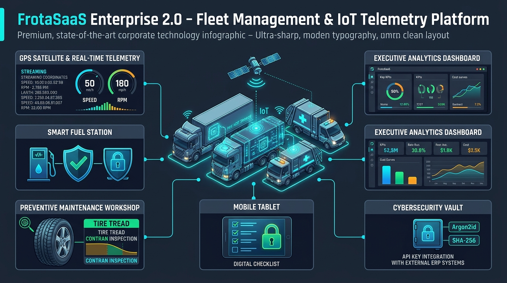

# Infográfico do Sistema - FrotaSaaS Enterprise 2.0
## Arquitetura Visual, Módulos Tecnológicos e Segurança Cibernética

---

### 1. Visão Geral em Alta Resolução



---

### 2. Decomposição Estrutural dos Pilares do Infográfico

O infográfico ilustra os 6 eixos de inteligência operacional que compõem o ecossistema corporativo do **FrotaSaaS Enterprise 2.0**:

```
 ┌────────────────────────────────────────────────────────────────────────┐
 │                      INFOGRÁFICO FROTASAAS 2.0                         │
 ├──────────────────────────────────┬─────────────────────────────────────┤
 │ 🛰️ 1. GPS & Telemetria IoT       │ 📊 2. Painel Executivo & KPIs       │
 │    • Streaming contínuo 4G       │    • Total de Ativos em Tempo Real  │
 │    • Velocidade, Ignição e RPM   │    • Disponibilidade e Manutenção   │
 │    • Odômetro e Temperatura      │    • Curvas de Custos Acumulados    │
 ├──────────────────────────────────┼─────────────────────────────────────┤
 │ ⛽ 3. Smart Fuel Station         │ 🔧 4. Manutenção & Pneus (CONTRAN)  │
 │    • Auditoria Antifraude        │    • Ordens de Serviço (Peças/MO)   │
 │    • Trava: Volume > Tanque      │    • Oficinas Credenciadas          │
 │    • Validação de Odômetro       │    • Alerta: Sulco de Pneu < 1.6 mm │
 ├──────────────────────────────────┼─────────────────────────────────────┤
 │ 📱 5. Mobile & Checklist Digital │ 🔐 6. Cyber Vault & Integração API  │
 │    • Trava de Segurança Bloqueante│   • Criptografia Argon2id (Senhas) │
 │    • Vistoria Pré e Pós-Viagem   │    • Hash SHA-256 (Chaves M2M)      │
 │    • Responsividade Android/iOS  │    • Conexão com ERPs e Gateways    │
 └──────────────────────────────────┴─────────────────────────────────────┘
```

---

### 3. Detalhamento dos Painéis do Infográfico

#### 🛰️ Painel 1: GPS Satellite & Real-Time Telemetry
* **Hardware Integrado**: Rastreadores GPS automotivos 4G/LTE (Suntech, Teltonika, Queclink) e módulos CANbus OBD2/J1939.
* **Métricas Transmitidas**:
  * Posição tridimensional precisa (Latitude, Longitude, Altitude no datum WGS 84).
  * Velocidade instantânea do veículo com cálculo de acelerações e desacelerações bruscas.
  * Regime de Rotação do Motor (RPM) para controle de condução econômica (faixa verde).
  * Status da Chave de Ignição e Odômetro Digital consolidado.
* **Processamento no Servidor**: Verificação automática de cercas eletrônicas permitidas e proibidas a cada ping recebido.

#### 📊 Painel 2: Executive Analytics Dashboard
* **Visão Panorâmica**:
  * **Indicadores em Tempo Real**: Ativos totais, veículos rodando em trânsito, ativos disponíveis no pátio e veículos retidos em manutenção.
  * **Curvas de Custos**: Separação transparente entre despesas de combustível, manutenção mecânica, troca de pneus e pedágios.
  * **Score Geral da Frota**: Média ponderada de segurança viária de todos os motoristas (escala de 0 a 100).
* **Filtro Multi-Secretaria**: Separação instantânea dos relatórios por órgão público (Saúde, Educação, Obras, Segurança, Administração).

#### ⛽ Painel 3: Smart Fuel Station (Auditoria Antifraude)
* **Barreira 1: Trava Volumétrica de Tanque**: Se o volume registrado na nota ou POS for superior à capacidade física do reservatório do veículo cadastrado no sistema (ex: 350L para tanque de 300L), o sistema marca o abastecimento imediatamente como **SUSPEITA DE FRAUDE** e bloqueia aprovação automática.
* **Barreira 2: Coerência de Odômetro**: O sistema verifica se o odômetro informado é estritamente crescente e compatível com a distância telemática percorrida pelo GPS.
* **Autonomia Instantânea**: Cálculo automatizado do consumo específico em $km/L$ e $L/km$.

#### 🔧 Painel 4: Preventive Maintenance & Tire Tread (Resolução CONTRAN)
* **Ordens de Serviço Estruturadas**: Discriminação de cada peça com código, quantidade e preço unitário, somados às horas de serviço e valor da mão de obra da oficina credenciada.
* **Inspeção de Pneus pelo Número de Fogo**:
  * Medição sistemática de sulco milimétrico.
  * **Alerta Crítico CONTRAN**: Quando a profundidade do sulco é inferior a **1.6 mm**, o pneu recebe a classificação `CRÍTICO` e exige substituição imediata, evitando acidentes e infrações gravíssimas de trânsito.

#### 📱 Painel 5: Mobile Tablet & Digital Checklist (Trava de Segurança)
* **Despacho Condicionado**: Nenhum veículo pode ser despachado operacionalmente sem a realização e aprovação prévia do Checklist Digital de Pré-Viagem.
* **Trava Mecânica de Segurança**: Caso o motorista reporte falha em qualquer componente essencial (sistema de freios, iluminação, pneus, fluido de freio ou direção), o sistema aplica a classificação **`REPROVADO_IMPEDIDO`** e rejeita qualquer tentativa de autorização de despacho.

#### 🔐 Painel 6: Cybersecurity Vault & API Key Gateway
* **Proteção de Senhas**: Armazenamento com **Argon2id** (vencedor da Password Hashing Competition, RFC 9106), imune a ataques de força bruta com placas de vídeo (GPU/ASIC).
* **Chaves de API M2M**: Chaves de integração no formato `flt_...` com alta entropia criptográfica e armazenamento estrito em **Hash SHA-256**.
* **Interoperabilidade Segura**: Conexão fluida com ERPs de contabilidade pública, empresas de cartão frota e sistemas de trânsito do DETRAN.
