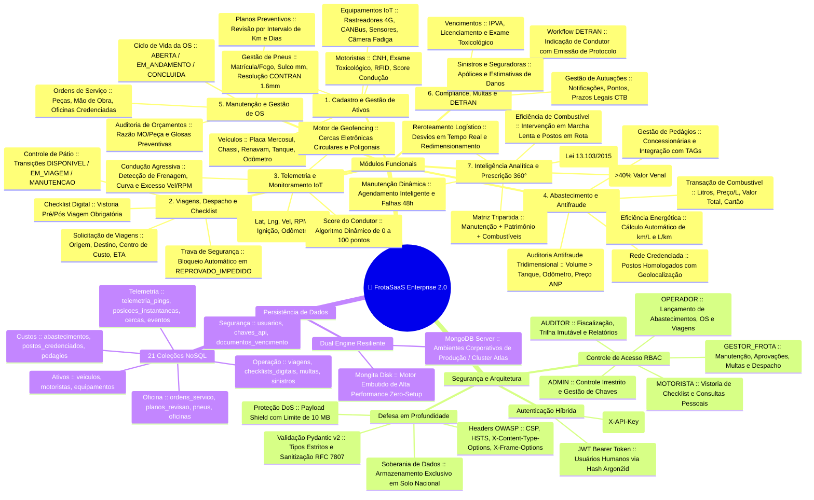
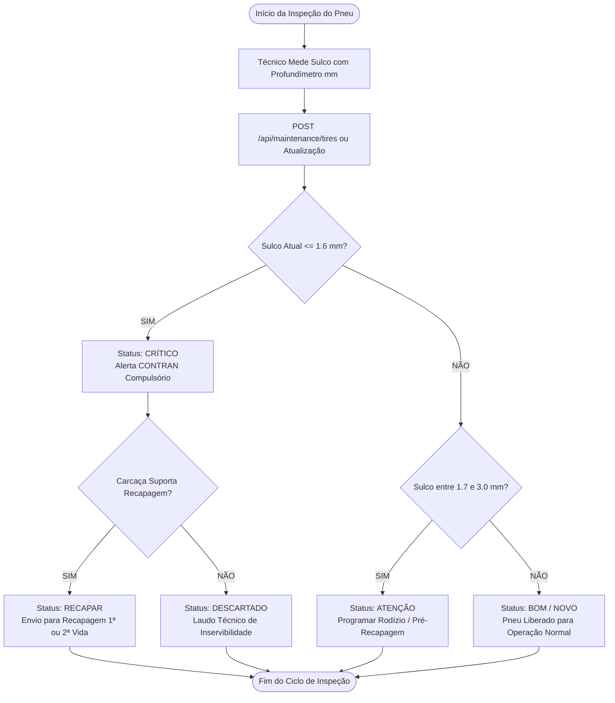
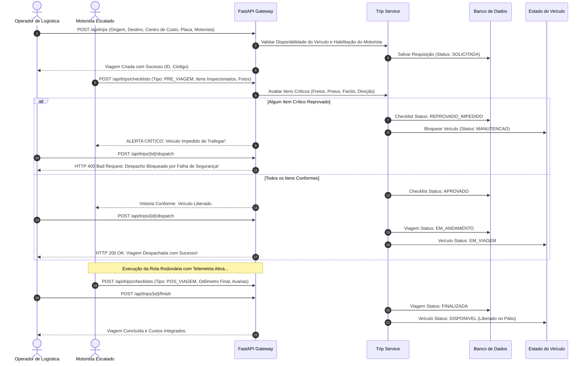
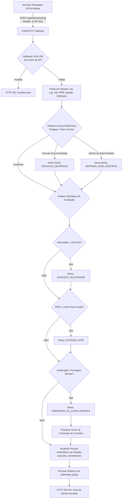
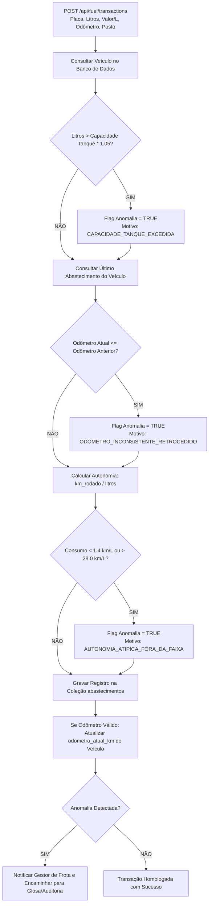
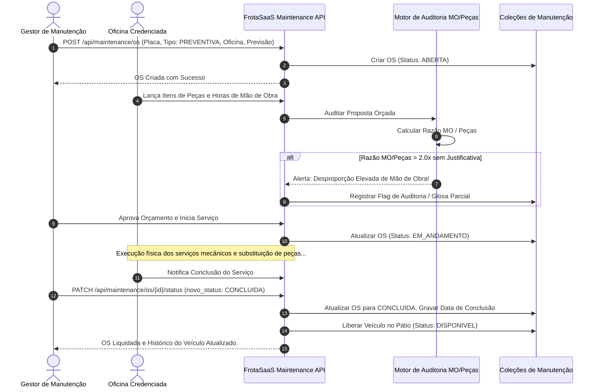
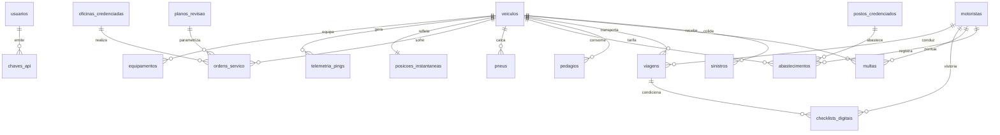

# Manual Técnico de Arquitetura, Mapeamento de Processos, Banco de Dados & API
## Plataforma FrotaSaaS Enterprise 2.0 & Telemetria IoT (Porta 8090)

---

### 1. Visão Geral do Ecossistema e Mapa Mental

O ecossistema **FrotaSaaS Enterprise 2.0** foi projetado para atender aos mais rigorosos padrões de segurança, resiliência operacional e prescrição analítica em frotas públicas e corporativas. O mapa mental abaixo sintetiza as conexões estruturais entre hardware embarcado, barramento de APIs, regras de negócio e tomada de decisão:



---

### 2. Mapeamento Aprofundado dos Processos e Fluxogramas por Módulo

Cada processo operacional do sistema foi mapeado formalmente com seus atores, validações de integridade, pontos de decisão e impactos no estado do banco de dados:

---

#### 2.1 Módulo 1: Gestão de Ativos, Cadastros e Pneus CONTRAN

##### Processo 1.1: Ciclo de Vida e Validação de Pneus (Resolução CONTRAN)
O controle de pneus monitora a espessura do sulco de borracha e determina compulsoriamente a transição de estado entre pneu novo, rodízio, recapagem e descarte:



---

#### 2.2 Módulo 2: Viagens, Despacho e Vistoria Digital com Trava de Segurança

##### Processo 2.1: Workflow de Despacho com Trava Preventiva
Nenhum veículo pode ser liberado no pátio sem que o checklist pré-viagem tenha sido preenchido e aprovado pelo motorista no aplicativo:



---

#### 2.3 Módulo 3: Telemetria IoT em Tempo Real e Detecção de Eventos

##### Processo 3.1: Ingestão de Telemetria, Geofencing e Cálculo de Score



---

#### 2.4 Módulo 4: Gestão de Combustíveis e Auditoria Antifraude Tridimensional

##### Processo 4.1: Triagem Antifraude em Abastecimento
O algoritmo de auditoria cruza o volume solicitado com a capacidade física cadastral do tanque do veículo e valida o histórico do hodômetro para estancar fraudes:



---

#### 2.5 Módulo 5: Manutenção, Gestão de OS e Auditoria de Peças

##### Processo 5.1: Ciclo de Vida da Ordem de Serviço (OS)



---

#### 2.6 Módulo 6: Compliance de Trânsito, Multas e Workflow DETRAN

##### Processo 6.1: Indicação de Condutor Infrator e Emissão de Protocolo DETRAN

```mermaid
flowchart TD
    Notificacao[Recebimento de Notificação de Infração CTB] --> CadastroMulta[POST /api/compliance/fines<br>Auto, Placa, Data/Hora, Local, Pontos, Valor]
    CadastroMulta --> ConsultaTelemetria[Consultar telemetria_pings e viagens no Instante da Infração]
    ConsultaTelemetria --> IdentificaMotorista{Condutor Localizado na Escala/GPS?}
    
    IdentificaMotorista -- SIM --> MotoristaConfirmado[Identificação Inequívoca do Condutor]
    IdentificaMotorista -- NÃO --> AlertaAuditoria[Alerta ao Gestor: Veículo em Uso sem Despacho Autorizado]
    
    MotoristaConfirmado --> SubmeterIndicacao[POST /api/compliance/fines/{id}/indicar<br>Motorista Identificador, Documento CNH]
    SubmeterIndicacao --> ValidaPrazo{Data Atual <= Limite Indicação?}
    
    ValidaPrazo -- NÃO --> MultaNIC[Inadmissível CTB: Risco de Multa NIC duplicada ao Órgão]
    ValidaPrazo -- SIM --> EmiteProtocolo[Gerar Protocolo Oficial: DETRAN-IND-YYYYMMDD-XXXXXX]
    
    EmiteProtocolo --> AtualizaMulta[Atualizar Multa: Status INDICADO_AGUARDANDO_DETRAN]
    AtualizaMulta --> AtualizaMotorista[Lançar Pontuação Provisória na CNH do Motorista]
    AtualizaMotorista --> FimMulta([Workflow Homologado e Arquivado])
```

---

#### 2.7 Módulo 7: Inteligência Prescritiva 360° e Tomada de Decisão

##### Processo 7.1: Orquestração dos 5 Pilares Prescritivos

```mermaid
flowchart LR
    subgraph Ingestao [Ingestão de Dados em Tempo Real]
        D1[(Telemetria IoT)]
        D2[(Manutenção OS)]
        D3[(Abastecimento)]
        D4[(Patrimônio SEA)]
    end

    subgraph Motores [Motores Analíticos e Prescritivos]
        P1[1. Manutenção Preventiva Dinâmica & Falhas 48h]
        P2[2. Eficiência Energética & Rota de Abastecimento]
        P3[3. Reroteamento Logístico & Dimensionamento]
        P4[4. Treinamento Sob Medida & Escala Anti-Fadiga]
        P5[5. TCO & Momento Ideal de Desinvestimento Leilão]
    end

    subgraph Acoes [Ações Prescritivas Operacionais]
        A1[Recomendar Parada Terça 14h / Trocar Válvula em 48h]
        A2[Alerta Marcha Lenta > 5 min / Abastecer Posto Rota R$ 5,89]
        A3[Desvio de Tráfego / Transferir 3 Viaturas Ociosas]
        A4[Bloqueio Motorista < 11h Repouso Lei 13.103/2015]
        A5[Alienação Compulsória Leilão Decreto 47.539/2018]
    end

    Ingestao --> Motores
    Motores --> Acoes
```



---

### 3. Detalhamento Completo do Banco de Dados

O sistema opera sobre uma arquitetura NoSQL Documental estruturada no **MongoDB / Mongita**, combinada com um banco analítico relacional **SQLite** (`dados/resultados_dissertacao.db`) para suporte aos modelos econométricos e prescrittivos da dissertação.

#### 3.1 Diagrama Entidade-Relacionamento do Banco de Dados (ERD)



#### 3.2 Especificação Detalhada das 21 Coleções do FrotaSaaS

| Coleção | Finalidade Principal | Chave Primária | Índices Críticos | Relacionamentos Principais |
| :--- | :--- | :--- | :--- | :--- |
| `usuarios` | Contas de acesso e RBAC | `_id` (ObjectId) | `username` (unique), `email` | `chaves_api.usuario_id` |
| `chaves_api` | Tokens M2M para IoT e ERPs | `_id` (ObjectId) | `hashed_key` (unique, SHA-256) | - |
| `veiculos` | Cadastro mestre de ativos da frota | `_id` (ObjectId) | `placa` (unique), `chassi` (unique) | `abastecimentos`, `ordens_servico`, `viagens` |
| `motoristas` | Condutores, CNH e Exame Toxicológico | `_id` (ObjectId) | `cpf` (unique), `cnh_numero` (unique) | `viagens`, `multas`, `checklists_digitais` |
| `equipamentos` | Rastreadores GPS, CANbus e câmeras | `_id` (ObjectId) | `identificador_serial` (unique) | `veiculos.placa` |
| `pneus` | Ciclo de vida e sulcagem CONTRAN 1.6mm | `_id` (ObjectId) | `numero_fogo` (unique) | `veiculos.placa` |
| `viagens` | Requisições e despacho de rotas | `_id` (ObjectId) | `codigo_viagem` (unique), `status` | `veiculos.placa`, `motoristas.id` |
| `checklists_digitais` | Vistorias pré e pós-viagem com travas | `_id` (ObjectId) | `viagem_id`, `veiculo_placa` | `viagens.id` |
| `telemetria_pings` | Histórico imutável de pacotes GPS IoT | `_id` (ObjectId) | `veiculo_placa`, `recebido_em` | `veiculos.placa` |
| `posicoes_instantaneas` | Última posição em tempo real no mapa | `_id` (ObjectId) | `veiculo_placa` (unique) | `veiculos.placa` |
| `cercas_eletronicas` | Geofencing circular e poligonal | `_id` (ObjectId) | `nome`, `ativo` | `veiculos.placa` |
| `eventos_conducao` | Frenagem, aceleração e excesso vel. | `_id` (ObjectId) | `veiculo_placa`, `timestamp` | `veiculos.placa`, `motoristas.id` |
| `abastecimentos` | Transações de combustível e antifraude | `_id` (ObjectId) | `veiculo_placa`, `odometro_km` | `veiculos.placa`, `postos_credenciados` |
| `postos_credenciados`| Postos homologados e preços ANP | `_id` (ObjectId) | `cnpj` (unique), `cidade` | `abastecimentos` |
| `pedagios` | Passagens em praças e débito de TAGs | `_id` (ObjectId) | `veiculo_placa`, `data_hora` | `veiculos.placa` |
| `ordens_servico` | Manutenção, peças e horas de MO | `_id` (ObjectId) | `id`, `veiculo_placa`, `status` | `veiculos.placa`, `oficinas_credenciadas` |
| `oficinas_credenciadas`| Oficinas mecânicas homologadas | `_id` (ObjectId) | `cnpj` (unique) | `ordens_servico` |
| `planos_revisao` | Intervalos preventivos (km/tempo) | `_id` (ObjectId) | `categoria_veiculo` | `ordens_servico` |
| `multas` | Autuações de trânsito e protocolo DETRAN | `_id` (ObjectId) | `auto_infracao` (unique) | `veiculos.placa`, `motoristas.id` |
| `sinistros` | Ocorrências, colisões e seguradoras | `_id` (ObjectId) | `numero_sinistro` | `veiculos.placa` |
| `documentos_vencimento`| Controle de IPVA, Licenciamento e Taxas| `_id` (ObjectId) | `veiculo_placa`, `tipo_documento` | `veiculos.placa` |

#### 3.3 Tabelas do Banco de Dados Analítico SQLite (`resultados_dissertacao.db`)

Para suportar o cruzamento tripartido da dissertação (**Manutenção + Patrimônio + Combustíveis**), o SQLite estrutura tabelas de alta volumetria:

* **`veiculos_frota_consolidada` (17.252 registros):** Cruza placa, marca, modelo, categoria, órgão, valor venal SEA, custo acumulado de manutenção, custo acumulado de combustível, razão gasto/venal e flag de elegibilidade para leilão (`razao_gasto_venal >= 0.40`).
* **`abastecimentos` (1.000.000 registros):** Histórico completo de 1 milhão de abastecimentos com flags auditadas (`flag_anomalia_volume`, `flag_anomalia_kml`, `flag_preco_discrepante`).
* **`manutencao_itens` (223.819 registros):** Todos os itens individuais de peças e serviços extraídos da base bruta estadual.
* **`veiculos_leilao` (30 veículos críticos):** Top veículos com manutenção estourada (>40% a 300% do valor venal) sujeitos a alienação imediata conforme Decreto 47.539/2018.

---

### 4. Especificação Completa da API RESTful

A API do **FrotaSaaS Enterprise 2.0** opera sob os padrões OpenAPI 3.0 / Swagger, oferecendo documentação interativa em `http://localhost:8090/docs` e especificação JSON em `http://localhost:8090/openapi.json`.

#### 4.1 Catálogo Exaustivo de Endpoints

| Método | Endpoint | Autenticação Requerida | Papéis Autorizados (RBAC) | Descrição e Finalidade |
| :---: | :--- | :--- | :--- | :--- |
| **GET** | `/api/health` | Pública | Todos | Verificação de status e saúde da API e banco de dados |
| **POST** | `/api/auth/login` | Pública | Todos | Login com credenciais e emissão de JWT Bearer (Argon2id) |
| **GET** | `/api/auth/me` | JWT Bearer | Todos os usuários logados | Retorna dados do perfil do usuário autenticado |
| **POST** | `/api/auth/api-keys` | JWT Bearer | `ADMIN` | Emissão de chave de API para IoT / M2M (X-API-Key) |
| **GET** | `/api/auth/api-keys` | JWT Bearer | `ADMIN` | Lista todas as chaves de API ativas e seus prefixos |
| **DELETE**| `/api/auth/api-keys/{id}` | JWT Bearer | `ADMIN` | Revogação imediata de chave de API M2M |
| **GET** | `/api/assets/veiculos` | Pública / JWT | Todos | Lista veículos com filtros por categoria, status ou busca |
| **POST** | `/api/assets/veiculos` | JWT Bearer | `ADMIN`, `GESTOR_FROTA` | Cadastro de novo veículo com validações de chassi e renavam |
| **GET** | `/api/assets/veiculos/{placa}` | Pública / JWT | Todos | Retorna ficha cadastral completa e odômetro do veículo |
| **PUT** | `/api/assets/veiculos/{placa}` | JWT Bearer | `ADMIN`, `GESTOR_FROTA` | Atualização cadastral ou de status do veículo |
| **GET** | `/api/assets/motoristas` | JWT Bearer | Todos | Lista condutores, categorias de CNH e validade toxicológica |
| **POST** | `/api/assets/motoristas` | JWT Bearer | `ADMIN`, `GESTOR_FROTA` | Cadastro de novo condutor com validações de CNH e CPF |
| **GET** | `/api/assets/motoristas/{id}` | JWT Bearer | Todos | Ficha completa do motorista e pontuação na CNH |
| **PUT** | `/api/assets/motoristas/{id}` | JWT Bearer | `ADMIN`, `GESTOR_FROTA` | Atualização de dados cadastrais ou renovação de CNH |
| **GET** | `/api/assets/equipamentos` | JWT Bearer | Todos | Lista rastreadores GPS, módulos CANBus e sensores |
| **POST** | `/api/assets/equipamentos` | JWT Bearer | `ADMIN`, `GESTOR_FROTA` | Cadastra equipamento embarcado vinculado a uma placa |
| **POST** | `/api/telemetry/ping` | `X-API-Key` ou JWT | `OPERADOR`, `ADMIN`, Dispositivos | Ingestão M2M de telemetria IoT em tempo real |
| **GET** | `/api/telemetry/live` | JWT Bearer | Todos | Retorna última posição geográfica de todos os veículos ativos |
| **GET** | `/api/telemetry/events` | JWT Bearer | Todos | Lista infrações de condução (velocidade, RPM, frenagem) |
| **GET** | `/api/telemetry/geofences` | JWT Bearer | Todos | Lista cercas eletrônicas cadastradas |
| **POST** | `/api/telemetry/geofences` | JWT Bearer | `ADMIN`, `GESTOR_FROTA` | Cria cerca eletrônica circular ou poligonal |
| **POST** | `/api/fuel/transactions` | JWT Bearer | `ADMIN`, `GESTOR_FROTA`, `OPERADOR` | Lança abastecimento com auditoria antifraude imediata |
| **GET** | `/api/fuel/transactions` | JWT Bearer | Todos | Consulta histórico de abastecimentos e flags de anomalia |
| **GET** | `/api/fuel/stations` | JWT Bearer | Todos | Lista postos credenciados conveniados e bandeiras |
| **POST** | `/api/fuel/toll` | JWT Bearer | `OPERADOR`, `GESTOR_FROTA`, `ADMIN` | Registra passagem em pedágio via tag eletrônica |
| **POST** | `/api/maintenance/tires` | JWT Bearer | `ADMIN`, `GESTOR_FROTA` | Cadastro de pneu com validação de sulco CONTRAN 1.6mm |
| **GET** | `/api/maintenance/tires` | JWT Bearer | Todos | Lista pneus da frota, quilometragem e status de desgaste |
| **GET** | `/api/maintenance/os` | JWT Bearer | Todos | Lista Ordens de Serviço com peças, serviços e oficinas |
| **POST** | `/api/maintenance/os` | JWT Bearer | `ADMIN`, `GESTOR_FROTA`, `OPERADOR` | Abre nova OS e vincula itens orçados de peças e MO |
| **PATCH**| `/api/maintenance/os/{id}/status`| JWT Bearer| `ADMIN`, `GESTOR_FROTA`, `OPERADOR` | Conclui OS e libera automaticamente o veículo no pátio |
| **GET** | `/api/trips` | JWT Bearer | Todos | Lista solicitações de viagem e rotas ativas |
| **POST** | `/api/trips` | JWT Bearer | `ADMIN`, `GESTOR_FROTA`, `OPERADOR` | Cria solicitação de viagem vinculada a um centro de custo |
| **POST** | `/api/trips/{id}/dispatch`| JWT Bearer | `ADMIN`, `GESTOR_FROTA`, `OPERADOR` | Despacha viagem (valida obrigatoriamente checklist aprovado) |
| **POST** | `/api/trips/{id}/finish` | JWT Bearer | `ADMIN`, `GESTOR_FROTA`, `OPERADOR`, `MOTORISTA` | Finaliza viagem e retorna veículo para DISPONIVEL |
| **POST** | `/api/trips/checklists` | JWT Bearer | `ADMIN`, `GESTOR_FROTA`, `OPERADOR`, `MOTORISTA` | Submete vistoria digital de pré ou pós-viagem |
| **GET** | `/api/compliance/fines` | JWT Bearer | Todos | Lista multas de trânsito e status da indicação do condutor |
| **POST** | `/api/compliance/fines` | JWT Bearer | `ADMIN`, `GESTOR_FROTA` | Registra notificação de autuação de trânsito |
| **POST** | `/api/compliance/fines/{id}/indicar`| JWT Bearer| `ADMIN`, `GESTOR_FROTA` | Executa workflow DETRAN e emite protocolo oficial |
| **GET** | `/api/reports/dashboard` | JWT Bearer | Todos | Retorna os principais KPIs da frota em tempo real |
| **GET** | `/api/reports/secretarias` | JWT Bearer | Todos | Consolidado de custos e consumos por secretaria |
| **GET** | `/api/reports/tco` | JWT Bearer | Todos | Relatório analítico de TCO e CPK (custo por km) |
| **GET** | `/api/reports/driver-ranking` | JWT Bearer | Todos | Ranking de segurança e score de motoristas (0 a 100) |
| **GET** | `/api/reports/export/csv` | JWT Bearer | Todos | Exportação RFC 4180 de custos de frota em formato CSV |
| **GET** | `/api/reports/compliance-national`| JWT Bearer| Todos | Auditoria de soberania nacional e residência de dados LGPD |
| **GET** | `/api/reports/prescriptive/full` | JWT Bearer | Todos | Relatório Prescritivo Master consolidado em 5 pilares |
| **GET** | `/api/reports/prescriptive/maintenance` | JWT Bearer | Todos | Prescrição de manutenção dinâmica e prevenção falhas 48h |
| **GET** | `/api/reports/prescriptive/fuel` | JWT Bearer | Todos | Ações de corte de marcha lenta e postos em rota de menor custo |
| **GET** | `/api/reports/prescriptive/logistics` | JWT Bearer | Todos | Redirecionamento em tempo real e taxa de ociosidade |
| **GET** | `/api/reports/prescriptive/drivers` | JWT Bearer | Todos | Treinamento sob medida e escala anti-fadiga (Lei 13.103/2015) |
| **GET** | `/api/reports/prescriptive/divestment-tco` | JWT Bearer | Todos | Análise TCO e recomendação de leilão (>40% valor venal) |

---

### 5. Documentos Complementares

* [MAPA_MENTAL_SISTEMA_FROTAS.pdf](file:///home/eduardo-note/Documentos/Dissertação/Geral_de_OS_23439885_202609110934%20(1)/sistema_gestao_frotas/docs/MAPA_MENTAL_SISTEMA_FROTAS.pdf)
* [DICIONARIO_DE_DADOS.md](file:///home/eduardo-note/Documentos/Dissertação/Geral_de_OS_23439885_202609110934%20(1)/sistema_gestao_frotas/docs/DICIONARIO_DE_DADOS.md)
* [GUIA_INTEGRACAO_API.md](file:///home/eduardo-note/Documentos/Dissertação/Geral_de_OS_23439885_202609110934%20(1)/sistema_gestao_frotas/docs/GUIA_INTEGRACAO_API.md)
* [MANUAL_DO_SISTEMA.md](file:///home/eduardo-note/Documentos/Dissertação/Geral_de_OS_23439885_202609110934%20(1)/sistema_gestao_frotas/docs/MANUAL_DO_SISTEMA.md)
